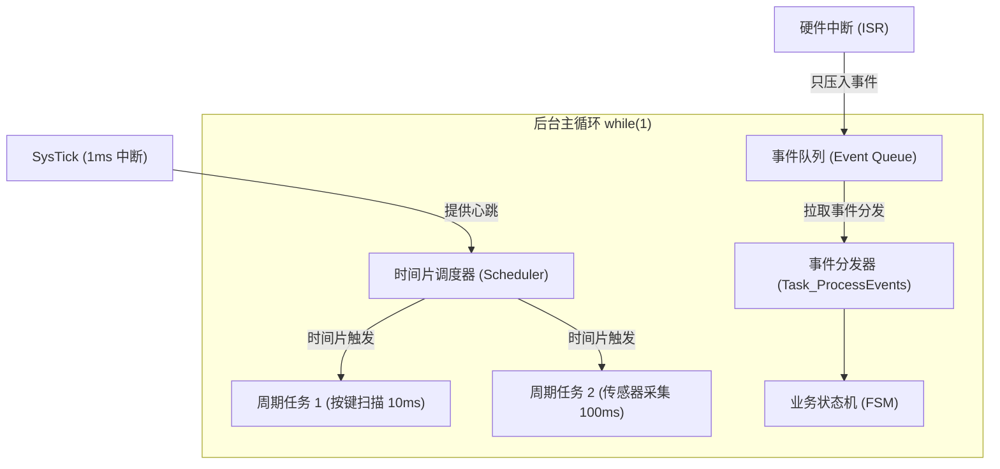

# 通用 MCU 裸机固件架构设计指南

本规范提炼自高可靠性嵌入式工程实践，面向所有主流 32 位/8 位单片机（STM32、GD32、CH32、NXP、ESP 等裸机环境）。旨在解决裸机代码中常见的**“业务硬件强耦合”、“全局变量滥用”、“满屏阻塞延时”、“中断卡死整机”**等顽疾。

---

## 1. 核心架构硬规则（Hard Rules）

1. **两轨隔离（Two-Track Layout）**：官方 SDK/外设库/启动文件归入 Vendor 轨，保持只读；自有代码全部放入 Project 轨，严禁混杂修改。
2. **单向分层依赖**：仅允许自顶向下单向包含，驱动层（Driver）绝对禁止包含板级头文件（BSP），中间件（Middleware）绝对禁止依赖硬件寄存器与驱动。
3. **零死等与超时传播（Fail-Closed Wait）**：所有等待硬件就绪、通信标志、时钟锁定的 `while` 循环**必须带有超时时限（Timeout/Deadline）**，并在超时发生时将错误码逐层向上抛出，严禁单片机死循环。
4. **中断极度克制（Lightweight ISR）**：ISR 严格遵循“快进快出”，只允许清标志、数据入环形队列、置位状态。绝对禁止在 ISR 中使用延时（`delay`）、等待阻塞或调用耗时复杂的函数。
5. **禁用动态内存分配**：除特异场景并单独审批外，禁止在裸机工程中使用 `malloc/calloc/free`，一律使用静态分配或对象池，彻底消除内存碎片和泄漏隐患。
6. **面向对象与实例封装**：驱动和组件统一采用结构体控制块（`Control Block`）管理状态，避免散落的全局状态变量，提升模块多实例复用能力。

---

## 2. 软件分层与两轨布局

### 2.1 目录组织结构

```text
<project-root>/
├── vendor/                   # 【Vendor 轨】厂商 SDK、外设库、启动文件（只读隔离）
│   ├── CMSIS/ / core/        # 内核支持（core_cm*.h / core_riscv.h）
│   ├── startup/              # 启动汇编（startup_*.s / .S）
│   └── peripheral/           # 芯片官方标准库或 HAL/LL 源文件
│
├── app/                      # 【Project 轨】应用业务层（每模块一独立目录）
│   ├── app_main.c/h          # 业务主逻辑
│   └── app_<module>/         # 独立业务模块（如 app_sensor, app_hmi）
│
├── bsp/                      # 【Project 轨】板级支持包（硬件接线组装）
│   ├── bsp_init.c/h          # 板级总初始化（时钟、引脚分配、外设挂载）
│   ├── bsp_pinmap.h          # 硬件引脚分配单一事实源（Pin Definition）
│   └── bsp_irq.c/h           # 中断优先级与分发管理
│
├── driver/                   # 【Project 轨】外设驱动层（Driver-Port 模式）
│   └── <name>/               # 每个外设一目录（如 driver/uart/、driver/spi_flash/）
│       ├── <name>.c/.h       # 通用设备操作逻辑
│       └── <name>_port.h     # 硬件适配抽象接口（外设基址、底层操作函数）
│
├── middleware/               # 【Project 轨】通用纯软件组件（完全脱离硬件）
│   ├── ringbuffer/           # 环形缓冲区
│   ├── scheduler/            # 协程/时间片任务调度器
│   ├── event_queue/          # 事件队列
│   └── protocol/             # 通信解析协议栈
│
├── config/                   # 【Project 轨】工程配置头文件
│   └── config_global.h       # 系统参数、全局宏定义、纯类型声明
│
└── docs/                     # 设计文档与硬件契约（引脚、时钟、内存映射）
```

### 2.2 分层调用依赖约束

```text
       ┌───────────────┐
       │      app      │  (业务逻辑：状态机、功能流程)
       └───────┬───────┘
          ┌────┴───────────────┐
          ▼                    ▼
   ┌─────────────┐      ┌──────────────┐
   │     bsp     │      │  middleware  │  (通用软件组件：队列/调度器/解析器)
   └──────┬──────┘      └──────┬───────┘
          ▼                    ▼
   ┌─────────────┐      ┌──────────────┐
   │   driver    │      │  port 抽象接口│  (纯接口定义，不依赖具体芯片)
   └──────┬──────┘      └──────────────┘
          ▼
   ┌─────────────┐
   │ vendor SDK  │  (底层寄存器/芯片厂商库)
   └─────────────┘
```

- **App 层**：调用 BSP 完成板级动作，调用 Middleware 进行业务数据处理。
- **BSP 层**：作为“胶水层”，将具体板子的引脚配置（`bsp_pinmap.h`）绑定到底层的 `driver`。
- **Driver 层**：纯通用设备逻辑，不关心当前驱动绑定在哪个 GPIO 引脚上。
- **Middleware 层**：纯 C 语言逻辑，可在 PC 模拟器上直接运行单测。

---

## 3. 裸机运行调度架构：时间片轮询 + 事件队列

推荐采用**“时间片轮询”驱动周期任务 + “环形事件队列”解耦中断与突发事件**的混合架构：



### 3.1 任务设计法则
- **非阻塞原则**：每个任务必须在极短时间内（通常 < 1ms）返回，禁止任何长延时死等。
- **状态机化拆分**：多步骤流程（如传感器发送指令 -> 等待转换完成 -> 读取数据）拆为状态机，分片执行。

---

## 4. 驱动解耦模型：Driver-Port 模式

外设驱动模块必须实现“逻辑”与“硬件”的剥离：

```c
/* driver/uart/uart.h - 驱动公开接口 */
typedef struct
{
    void *instance;                     /**< 外设寄存器基地址指针 */
    int (*tx_byte)(void *inst, uint8_t ch);
    int (*rx_byte)(void *inst, uint8_t *ch);
} Uart_Driver_t;

int  Uart_Init(Uart_Driver_t *driver);
int  Uart_Send(Uart_Driver_t *driver, const uint8_t *data, uint16_t len, uint32_t timeout_ms);
void Uart_HandleIrq(Uart_Driver_t *driver);
```

- 在 `bsp/` 中定义具体的引脚、波特率，并填充 `Uart_Driver_t` 实例；
- 当更换 MCU 芯片时，**只需重写 Port/BSP 绑定，所有外设驱动和上层业务逻辑 100% 复用**。

---

## 5. 防御式编程（Fail-Closed）关键实践

### 5.1 硬件等待必须带超时
```c
/* 错误写法：死循环等待标志，硬件异常时整机卡死 */
while (!(USART1->SR & USART_FLAG_TC));

/* 正确写法：包含超时时限并向上报告错误 */
uint32_t deadline = SysTick_GetTick() + TIMEOUT_MS;
while (!(USART1->SR & USART_FLAG_TC))
{
    if (SysTick_GetTick() >= deadline)
    {
        return ERR_TIMEOUT; /* 超时退出，由上层重试或降级告警 */
    }
}
```

### 5.2 中断前后台安全交换
- 中断与主循环共享的变量必须使用 `volatile` 修饰；
- 复杂数据传输一律使用**单生产者单消费者（SPSC）无锁环形缓冲区（RingBuffer）**，避免关中断带来的系统抖动。

---

## 6. 深入参考与模板

本规范配套详细的实现参考与开箱即用代码：
- [工程两轨布局与分层指南](references/layout.md)
- [调度器与事件驱动架构指南](references/scheduling.md)
- [Driver-Port 硬件解耦模式详解](references/driver-port.md)
- [防御式编程与安全红线](references/safety-rules.md)
- [通用时间片与事件调度器源码模板](templates/scheduler.h)
- [无锁环形缓冲区源码模板](templates/ringbuffer.h)
